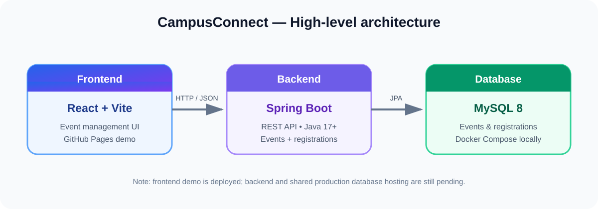

<!-- CampusConnect project README -->
<p align="center">
  
</p>

<h1 align="center">CampusConnect</h1>
<p align="center"><strong>A campus event management platform</strong></p>
<p align="center">
  <a href="https://anuragchaurasiya.github.io/repo08/"><strong>Live Frontend Demo</strong></a>
  ·
  <a href="https://github.com/anuragchaurasiya/repo08/actions"><strong>Build &amp; Deployment</strong></a>
</p>

<p align="center">
  
  
  
  
  
  
</p>

CampusConnect helps students discover and manage campus events. Organizers can create and maintain events, while attendees can register for events. The repository contains a React frontend, a Spring Boot REST API, and MySQL development configuration.

> **Current project status:** The frontend demo is deployed on GitHub Pages. The backend API and MySQL setup are included for local development; public backend hosting and a shared production database are not configured yet. In demo mode, browser data is stored locally and is not shared between visitors.

## Preview

<p align="center">
  
</p>

**Live demo:** [Open CampusConnect](https://anuragchaurasiya.github.io/repo08/)

## Features

- Create, view, edit, and delete campus events
- Validate required event details
- Register attendees with name and email
- Prevent duplicate registrations for the same event and email
- View attendee counts and registration records
- Cancel an attendee registration
- MySQL persistence for local backend development
- GitHub Actions workflows for CI and frontend deployment

## Technology stack

| Layer | Technology |
|---|---|
| Frontend | React 19, Vite, JavaScript |
| Backend | Java 17+, Spring Boot, Spring Data JPA, Bean Validation |
| Database | MySQL 8 |
| Local database | Docker Compose |
| Automation | GitHub Actions |

## Repository layout

```text
repo08/
├── .github/workflows/   # CI and GitHub Pages deployment
├── backend/             # Spring Boot REST API and tests
├── frontend/            # React + Vite application
├── docs/images/         # Project banner and architecture diagram
├── docker-compose.yml  # Local MySQL service
├── CONTRIBUTING.md
└── README.md
```

## Run locally

### Prerequisites

- Java 17 or newer
- Maven
- Node.js and npm
- Docker Desktop (for the local MySQL database)

### 1. Start MySQL

Run this from the repository root:

```bash
docker compose up -d
```

The development database is exposed on host port `3307` and uses MySQL's internal port `3306`.

### 2. Start the backend

Open a terminal:

```bash
cd backend
mvn spring-boot:run
```

The API is available at `http://localhost:8080/api/events`.

### 3. Start the frontend

Open a second terminal:

```bash
cd frontend
npm install
npm run dev
```

Open the local URL printed by Vite (usually `http://localhost:5173`).

## REST API

Base URL: `/api/events`

| Method | Endpoint | Description |
|---|---|---|
| GET | `/api/events` | List all events |
| GET | `/api/events/{id}` | Get one event |
| POST | `/api/events` | Create an event |
| PUT | `/api/events/{id}` | Update an event |
| DELETE | `/api/events/{id}` | Delete an event |
| POST | `/api/events/{eventId}/registrations` | Register an attendee |
| GET | `/api/events/{eventId}/registrations` | List registrations (name and registration time) |
| GET | `/api/events/{eventId}/registrations/count` | Get attendee count |
| DELETE | `/api/events/{eventId}/registrations/{registrationId}` | Cancel a registration |

Example event request:

```json
{
  "title": "Tech Fest",
  "description": "Annual campus technology festival",
  "venue": "Main Auditorium",
  "eventDate": "2027-02-15T10:00:00"
}
```

## Configuration and security

The backend reads database configuration from environment variables:

- `DB_URL`
- `DB_USERNAME`
- `DB_PASSWORD`

Local defaults are for development only. Use strong, private credentials in deployment, store secrets in the hosting provider's secret manager, and never commit real passwords or API keys.

## Project roadmap

- [x] React frontend scaffold and event management UI
- [x] Spring Boot event CRUD API
- [x] Attendee registration API and duplicate-registration prevention
- [x] Automated backend tests and frontend production build
- [x] GitHub Pages frontend demo
- [ ] Connect the public frontend to a hosted backend API
- [ ] Deploy backend and configure a managed production database
- [ ] Add secure user authentication
- [ ] Add organizer/admin roles and authorization
- [ ] Add end-to-end frontend tests

## Contributing

Contributions and suggestions are welcome. Please read [CONTRIBUTING.md](CONTRIBUTING.md) before opening a pull request.

## License

No open-source license has been selected yet. All rights are reserved by default. Please ask the repository owner before reusing or redistributing this project.
